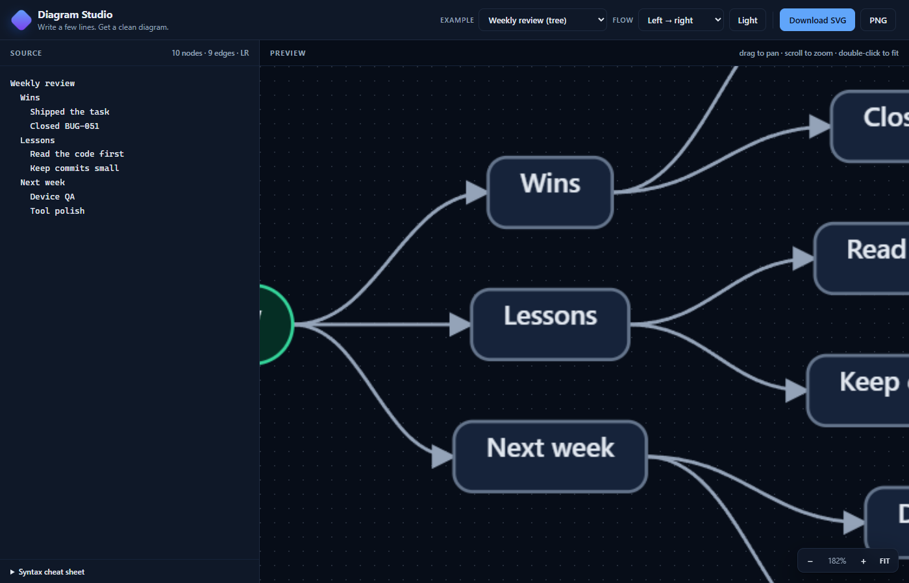

# Diagram Studio

Offline, zero-dependency text → diagram tool. Type a few simple lines, get a clean
SVG you can drop into reports, books, notes or slides, and download it as SVG or PNG.

No install, no account, no internet, no image-generation model. Static files, no build step, straight from disk.



## Use it

**Browser (normal way):** double-click `index.html` (Edge/Chrome). Edit on the left,
preview on the right. Drag to pan, scroll to zoom, double-click to fit.

**CLI (for scripts and books):**

```powershell
node cli.js examples/report-pipeline.txt -o report.svg
node cli.js examples/company-map.txt --theme dark -o company.svg
Get-Content notes.txt | node cli.js - -o notes.svg
node cli.js examples/report-pipeline.txt -o report.svg --json
```

The CLI prints node/edge counts and canvas size. Exit code `1` means a parse error.

`--json` switches the summary to one line of machine-readable JSON and still writes the SVG:

```json
{"ok":true,"out":"report.svg","nodes":6,"edges":5,"width":640,"height":420,"dir":"LR"}
```

On a parse error it prints `{"ok":false,"errors":[{"line":2,"message":"..."}]}` on stdout,
exits `1` and writes no SVG. Usage errors still exit `2`.

## Syntax

```
title: Report pipeline
direction: LR            # LR or TB (default)

A [Box label]            # rectangle
B (Pill label)           # stadium / start
C {Decision?}            # diamond
D ((End))                # circle

A -> B                   # solid arrow
A -> B : edge label      # labelled arrow
A ->|label| B            # same, mermaid-ish
A -.-> B                 # dashed
A <-> B                  # two-way
A -> A                   # self loop
```

Nodes can be defined on an edge (`A [Start] -> B`), on their own line, or not at all
(the id becomes the label).

**Groups:**

```
group Money {
  Salary -> Bills
  Salary -> Savings
}
```

**Trees / mind maps:** if a block has no arrows and at least one indented line, it
becomes a left-to-right tree. Two spaces per level.

```
Weekly review
  Wins
    Shipped the task
  Lessons
    Read the code first
```

Other rules:

- `\n` inside a label makes a second line.
- Quotes keep commas/colons inside a label: `A["One, two: three"] -> B`.
- Lines starting with `#` or `//` are comments.
- `graph LR` / `flowchart TB` are accepted as direction directives.
- Cycles are allowed; back edges are routed around the side.

## What it produces

- Layered layout: longest-path ranks, median ordering sweeps, no node overlaps.
- Rounded boxes, diamonds, pills, circles, dashed/two-way edges, edge labels,
  group boxes, optional title.
- Light and dark themes. Exports include the background, so they look right in
  Word/Docs/PDF without extra styling.
- SVG is self-contained (markers and inline styles); PNG export is 2× scale.

## Files

| File | What |
|---|---|
| `index.html` | app shell |
| `styles.css` | UI styles |
| `core.js` | parser + layout + SVG renderer (pure, works in Node) |
| `app.js` | editor, pan/zoom, theme, export, autosave |
| `cli.js` | headless SVG generation |
| `test-core.js` | 21 parser/layout/render/CLI checks |
| `verify.js` | one-command gate: tests, CLI smoke, docs and links |
| `docs/` | architecture, spec, code map, decisions, troubleshooting |
| `AGENTS.md` | entry point for AI agents working on the tool |
| `examples/` | sample inputs |

## Docs

Start at `docs/00-index.md` (30-second summary + reading paths). Architecture and module
diagrams are generated from `docs/assets/*.dsl` with this tool. Every change must keep
`node verify.js` green.

## Verify

```powershell
node verify.js
```

It runs the 21 core checks, a CLI smoke test, and the docs gate (required files, front
matter, links, CODEMAP coverage, no dependencies).

## Known limits

- `RL` / `BT` are accepted but rendered as `LR` / `TB`.
- Groups are visual clusters (one nesting level); keep members near each other.
- Very wide ranks get wide rather than wrapping; split the diagram or use `direction`.
- Browser autosave lives in `localStorage`; export if the text matters.

## License

MIT, see [LICENSE](LICENSE).
