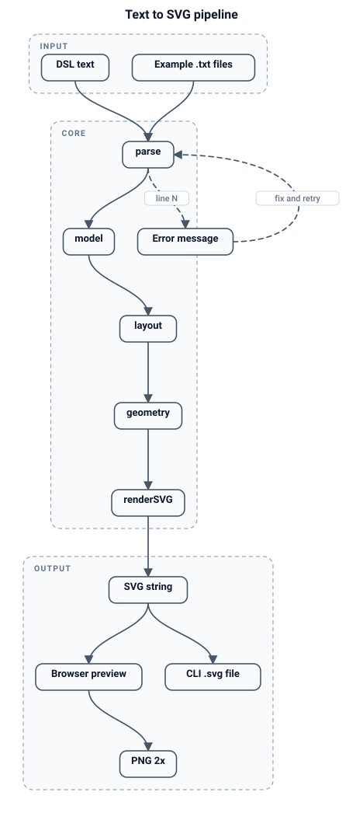

# Architecture



## Goals and non-goals

**Goals:** deterministic, offline, dependency-free diagrams from compact text; a pure core
usable from a browser and a CLI; output that survives Word/Docs/PDF.

**Non-goals:** a drag-and-drop editor, arbitrary graph layout quality (Graphviz-class
obstacle routing), animation, collaboration, or a general-purpose graphics language.

## Pipeline

```
text ──parse()──▶ model ──layout()──▶ geometry ──renderSVG()──▶ SVG string
                    │                     │
                    └── errors (line)     └── positions, paths, bounds, lane offsets
```

Three stages, three contracts. The browser and the CLI only orchestrate them.

### 1. `parse(text)` → `{ ok, errors, error, model }`

- Line-oriented; keeps `line` numbers for errors and tree mode.
- Precedence per line: directive → group open/close → edge → node → error.
- Never throws on user input; diagnostics accumulate in `errors` (first one also as
  `error`). A partial `model` is still returned.
- Node identity is the trimmed id string. First mention creates it; later mentions merge
  label/shape/group without overwriting an explicit shape with `box`.
- Group membership is the innermost open group at first creation.
- If the document has no arrows and at least one indented line, it becomes a **tree**:
  indentation builds parent edges, the first item is a stadium, default direction `LR`.
- `RL`/`BT` are accepted and normalized to `LR`/`TB`.

Model shape:

```
{
  title, direction: 'LR'|'TB',
  nodes: { [id]: { id, label, shape, group, order } },
  order: [id],                    // creation order, stable
  edges: [{ from, to, label, style: 'solid'|'dashed'|'both', order }],
  groups: [{ id, label, members: [id] }]
}
```

Shapes: `box` (default), `stadium`, `diamond`, `circle`.

### 2. `layout(model)` → geometry

```
{
  dir, title, order,
  nodes: { [id]: { x, y, w, h, cx, cy, rank, lines } },
  edges: [{ from, to, label, style, path, labelPos }],
  groups: [{ id, label, x, y, w, h }],
  width, height
}
```

Algorithm:

1. **Cycle handling.** DFS over insertion order; edges to a gray node are marked back
   edges. They are excluded from ranking and routed around the canvas.
2. **Ranks.** Longest-path relaxation on the remaining DAG (`rank[to] = max(rank[to],
   rank[from] + 1)`), capped by one pass per node.
3. **Ordering.** Bucket by rank, then six median sweeps (down, up, …) using predecessor /
   successor positions, with current index as a stable tie-breaker.
4. **Sizing.** Labels split on `\n`; width from canvas `measureText` (7.1 px/char fallback
   in Node) + padding; diamonds scale 1.4× and add height; circles become square-ish.
   Constants: `rankGap = 78`, `nodeGap = 30`, `PAD = 30`, title band `40`.
5. **Positions.** TB: ranks stack on `y`, nodes centre horizontally inside the rank. LR:
   mirror. Coordinates are normalized to start at `(30, 30 + titleBand)`.
6. **Groups.** A dashed box is the union of member rects, padded 16 px, with a 26 px label
   band on top. Groups are visual only; they do not affect ranks.
7. **Edges.** Forward adjacent edges connect the facing sides with cubic Béziers.
   Equal-rank, back, and **rank-skipping** edges take an outside lane: right side in TB,
   below the content in LR (`+54 + 18·n` per edge to avoid stacking). Self loops are drawn
   above (TB) or to the right (LR).
8. **Bounds.** Canvas = content ∪ group boxes ∪ lane offsets + padding; minimum
   `200 × 140`; title width can widen the canvas.

Layout is deterministic: no randomness, timestamps, or hash iteration. All node/edge
iteration follows `order`/array order.

### 3. `renderSVG(model, geometry, opts)` → string

- `opts.theme`: `light` (default) or `dark` from `THEMES`.
- `opts.background`: default `true` for export. The app passes `false` for the preview so
  the dotted stage shows through.
- Draw order: background → title → groups → edges → nodes.
- One marker (`ds-arrow`, `orient="auto-start-reverse"`) serves both ends; bidirectional
  edges add `marker-start`.
- Edge labels sit at the cubic midpoint with an opaque rounded background.
- Text uses a system font stack; nothing is loaded over the network.
- Output has numeric `width`/`height` and a matching `viewBox`; exporters rely on this.

### Browser shell (`app.js`)

- `input` event → 220 ms debounce → `parse` → `layout` → `renderSVG(background:false)`.
- Parse failure keeps the last good render and shows the line number.
- Autosave: `localStorage["diagram-studio-v1"] = { text, theme }` (400 ms debounce).
- Pan/zoom is a CSS transform on the `<svg>` (`translate` then `scale`), range 0.2–8;
  wheel zooms at the pointer; double-click fits.
- Exports re-render from the model, not from the transformed DOM:
  `slug(title).svg`; PNG is 2× unless the canvas would exceed 6000 px.
- Direction select rewrites the `direction:` line in the source.

### CLI (`cli.js`)

- Reads a file or stdin (`-`), parses, optionally overrides theme/direction, lays out,
  writes one SVG.
- Exit codes: `0` success, `1` parse error, `2` bad arguments / IO.
- Prints one summary line: file, nodes, edges, size, direction.

## Boundaries and failure modes

- `core.js` never touches `document` except inside the guarded `measure()` helper, so
  `require('./core.js')` works in Node.
- Layout does not know about themes; the renderer does not know about ranks.
- Bad input is reported, not thrown. Incomplete input still returns a model so the UI can
  show partial state.
- Recursion is used for cycle detection; keep diagrams under a few hundred nodes.
- Marker ids are global per SVG document. Embedding two SVGs with different themes in one
  HTML page can make one use the other's arrow color (same id).

## Scale notes

Parse is O(lines). Layout is O(V + E) per sweep with a small constant. Rendering is O(V +
E). The practical limit is label width and rank width, not CPU. Very wide ranks are not
wrapped; split the diagram or switch direction.

See [DECISIONS.md](DECISIONS.md) for why the layout is custom, and
[CODEMAP.md](CODEMAP.md) for symbol-level ownership.
