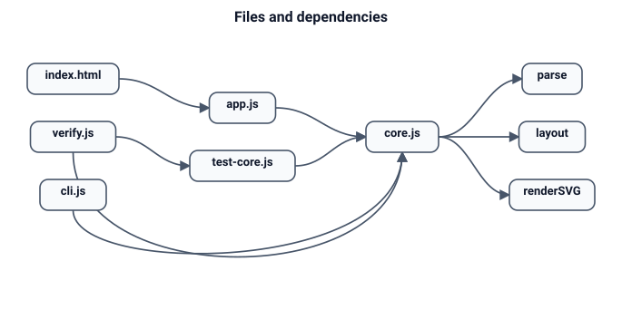

# Code map

Symbol-level ownership. Line numbers are intentionally omitted so the map does not rot;
search the symbol name instead.

## Files

| File | Approx. | Owns |
|---|---|---|
| `core.js` | 24 KB | DSL parser, graph layout, SVG rendering, themes. Pure, UMD (browser + Node). |
| `app.js` | 12 KB | Editor wiring, render loop, pan/zoom, theme, autosave, SVG/PNG download. |
| `index.html` | 3 KB | App shell, toolbar, source pane, stage, cheat sheet. |
| `styles.css` | 8 KB | App UI only. Never affects exported SVG. |
| `cli.js` | 3 KB | Headless SVG generation, argument parsing, exit codes. |
| `test-core.js` | 5 KB | 14 behavioral checks for parse/layout/render. |
| `verify.js` | — | One-command gate: tests + CLI smoke + docs/link/CODEMAP checks. |
| `README.md` | 3 KB | Human quick start and syntax summary. |
| `AGENTS.md` | 3 KB | AI entry: read order, invariants, done checklist. |
| `docs/` | — | This kit. `docs/assets/*.dsl` regenerate the diagrams. |
| `out/` | — | Generated samples (`report.svg`, `company.svg`, `weekly.svg`, `preview.png`). Not source. |

## `core.js`

| Symbol | Responsibility | Invariant |
|---|---|---|
| UMD wrapper | Export `DiagramCore` in browser, `module.exports` in Node | No top-level DOM access |
| `THEMES` | Color tokens for `light` / `dark` | Renderer reads only this; no hard-coded colors elsewhere |
| `esc` | XML/HTML escaping | Every text/label passes through it |
| `slug` | Safe filename / group id | Lowercase, `[a-z0-9-]` |
| `measure` | Text width (`canvas` in browser, 7.1 px/char in Node) | Guarded DOM; never required |
| `labelText` | Trim, strip wrapping quotes, turn `\n` into a line break | One source of label normalization |
| `ARROW_RE` / `nodeToken` | Tokenize an edge / a node reference | Shapes: box, stadium, diamond, circle |
| `parse` | Text → model + line errors | Never throws on input; deterministic order |
| `parse → touch` | Create/merge a node, assign group | First explicit shape wins over implicit box |
| `parse → finishModel` | Backfill edge-only nodes, collect group members | Groups without members are dropped |
| `layout` | Model → geometry | Deterministic; renderer never recomputes |
| `layout → DFS` | Mark back edges | Excluded from ranking |
| `layout → ranks` | Longest-path ranks | Bounded by node count |
| `layout → sweeps` | Median ordering | Stable fallback = current index |
| `layout → sizes` | Node boxes from labels/shapes | Diamond 1.4× width; circle square |
| `layout → edge routing` | Forward curves + outside lanes for back/skip/equal | Lane index prevents overlap |
| `layout → cubicMid` | Edge-label anchor | Uses the same cubic as the path |
| `layout → bounds` | Canvas width/height | Minimum 200×140; includes lanes and groups |
| `renderSVG` | Geometry + theme → SVG string | Draw order: bg, title, groups, edges, nodes |

## `app.js`

| Symbol | Responsibility |
|---|---|
| `EXAMPLES` / `populateExamples` / `loadExample` | Five built-in, tested-by-eye inputs |
| `loadSettings` / `saveSettings` / `scheduleSave` | `localStorage` round-trip, guarded for `file://` |
| `applyTheme` | Sets `data-theme` + button label |
| `renderNow` / `scheduleRender` | Debounced parse → layout → render; error banner |
| `applyView` | CSS transform + zoom label |
| `setDirection` | Rewrites/inserts the `direction:` directive |
| `fit` / `zoomAt` / `zoomCenter` | Pan/zoom math (0.2–8, pointer-anchored) |
| `exportSVG` / `exportPNG` / `download` | Fresh render for export; PNG 2× (cap 6000 px) |
| `bind` | All listeners: input, keys, wheel, pointer drag, exports |
| `boot` | Restore settings, apply theme, first render |

## `cli.js`

| Symbol | Responsibility |
|---|---|
| `parseArgs` | `-o/--out`, `--theme`, `--direction`, `-`, `--help` |
| `main` | Read, parse, optional overrides, layout, write, summary line |

Exit codes: `0` ok, `1` parse error, `2` bad args/IO/theme.

## Where to change what

### Add a node shape

1. `core.js` `nodeToken()` — recognize the delimiters.
2. `core.js` `layout()` sizing — width/height rules for the shape.
3. `core.js` `renderSVG()` — draw the polygon/rect/circle.
4. `docs/SPEC.md` shape table.
5. `test-core.js` — parse assertion + render assertion.

### Add an edge style

1. `ARROW_RE` — add the token (longest match first).
2. `parse()` — map the token to `style`.
3. `renderSVG()` — dash pattern / marker / width.
4. `docs/SPEC.md` + `test-core.js`.

### Add a directive

1. `parse()` main loop (directives run before edges).
2. Tree-mode pre-scan if it should also work there.
3. `docs/SPEC.md` + a test.

### Change layout

Only `layout()`. Keep the geometry contract stable (see ARCHITECTURE). Add a regression
test for overlap/bounds if the change can move nodes.

### Add an export format

`app.js` export function + `download()`; update `docs/SPEC.md` UI contract. CLI stays
SVG-only unless the format works in Node without new dependencies.

### Change the look

`THEMES` + `renderSVG()` style attributes. Never move geometry into the renderer.

## Test map

| Check in `test-core.js` | Protects |
|---|---|
| shapes, labels, dashed, both | Parser precedence + styles |
| quoted labels | Label/colon/comma handling |
| indented tree | Tree detection + LR default |
| cycles and self loops | Back-edge routing, finite geometry |
| no same-rank overlap | Ordering/packing invariant |
| nodes inside canvas | Bounds + padding |
| groups | Group membership + box rendering |
| LR chain | Direction + orientation |
| graph/flowchart directives | Compatibility aliases |
| themes + SVG shell | Escaping, background, markers, node count |
| stray `}` line number | Error reporting |
| trailing arrow line number | Edge with no target |
| deterministic layout | Same model → identical positions and paths |
| empty input | Blank-canvas path |

Manual checks (documented in DEVELOPMENT): browser render, theme toggle, pan/zoom,
autosave, SVG download, PNG download, headless screenshot.

## Invariants and where they are enforced

| Invariant | Enforced by |
|---|---|
| No runtime dependencies | `verify.js` scans `require()` calls |
| `core.js` runs in Node | `test-core.js` requires it |
| Deterministic output | Layout uses ordered arrays; determinism check in tests |
| Exports include background | CLI SVG smoke checks the background rect |
| Docs are complete and linked | `verify.js` |
| Every source file is mapped | `verify.js` checks CODEMAP coverage |

## Symptom → first file

| Symptom | Open |
|---|---|
| Wrong parse/shape/label | `core.js` `parse()` |
| Overlap, clipping, odd lanes | `core.js` `layout()` |
| Wrong colors/text in SVG | `core.js` `renderSVG()` |
| UI button/zoom/export broken | `app.js` |
| CLI flags/exit code | `cli.js` |
| Docs/link/coverage failure | `verify.js` |
